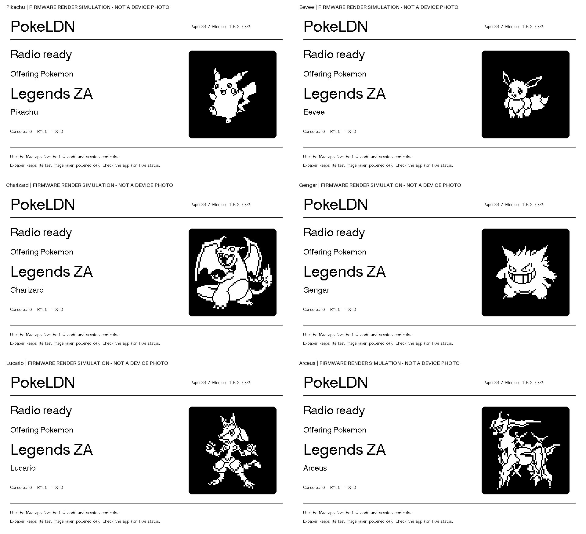
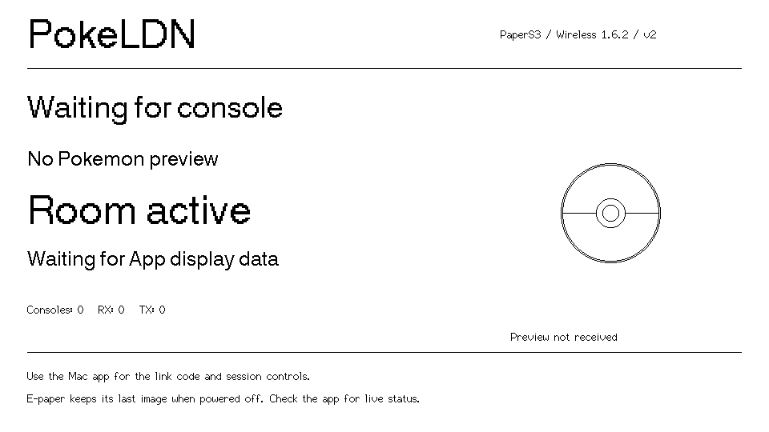

<p align="center">
  
</p>

# pokeldn：PaperS3 電子紙版本

[English](README.md) | [繁體中文](README.zh-TW.md)

這是 [Decryptu/pokeldn](https://github.com/Decryptu/pokeldn) 的 fork，新增
**M5Stack PaperS3 電子紙狀態畫面**。基於 PokeLDN v0.32.0、無線韌體 1.6.2
與 ESP-IDF v6.1，沿用原有電腦 App、USB 通訊與 DISPLAY 協定。

PokeLDN 透過 USB 連接 ESP32，與 Switch／Switch 2 上的寶可夢遊戲進行本地無線通訊，
不需要在遊戲主機安裝軟體。原專案支援 Apple Silicon macOS、Windows、Linux，
也提供 Android USB 與 iOS／iPadOS 藍牙版本；**本 fork 的 PaperS3 只驗證了 Mac USB 使用情境**。

## PaperS3 電子紙畫面



上圖是**直接使用韌體繪圖函式、M5GFX 字型與 DISPLAY 資料解析器產生的模擬圖**，
不是實機照片或 Mac App 截圖。每個畫面的內容區為 960×540；
圖集上方的模擬圖標示不屬於裝置介面。模擬不包含面板刷新波形、殘影與環境光。

目前功能：

- 顯示無線裝置就緒、建立房間、加入與連線狀態。
- 顯示遊戲、寶可夢名稱、黑白像素外觀與連線台數。
- 顯示定期取樣的 RX／TX 計數。
- 沒有圖片時顯示精靈球；App 需下載或快取圖片，才能提供寶可夢外觀。
- 使用適合電子紙的低頻快照刷新，不播放原 OLED 的動畫。

連線代碼與操作仍在電腦 App。現有 DISPLAY 協定沒有連線代碼欄位；
文字最多 21 個 ASCII 字元，**目前裝置畫面仍為英文，不會因這份中文文件改成中文介面**。
沒有加入觸控選單或獨立操作功能。電子紙斷電後會保留最後畫面，請以 App 判斷即時狀態。

圖片來自 [PokeAPI/sprites](https://github.com/PokeAPI/sprites)，透過上游的黑白轉換程序處理。
這些是顯示測試素材，不代表圖中每隻寶可夢都可作為所選遊戲的合法交換資料。

## 已驗證範圍

測試日期：2026-10-20，裝置為 ESP32-S3 rev 0.2、16 MB Flash／8 MB PSRAM 的 PaperS3。

| 項目 | 結果 |
|---|---|
| 原始完整 Flash 備份 | 16 MiB 讀取兩次，SHA-256 一致；只保存在本機 |
| 電子紙韌體寫入 | 已取得授權，寫入後獨立讀回校驗一致 |
| 實體畫面 | 使用者確認初始文字、方向及皮卡丘外觀正常 |
| 六隻寶可夢輪播 | 皮卡丘、伊布、噴火龍、耿鬼、路卡利歐、阿爾宙斯均回報完成刷新 |
| USB／顯示壓力測試 | 180 秒、60 次狀態查詢、12 次文字切換及返回 AUTO、4 次 2 MB 傳輸通過 |
| 測試期間穩定性 | 沒有新增協定錯誤、觀察到的重啟或斷線 |
| 原版 App 與 Z-A 主機模式 | 辨識裝置；AP／hosting 維持 15 秒後正常停止 |
| DISPLAY／解析器測試 | 25 項測試通過 |
| Switch 實際加入、LDN 驗證及交換 | **未驗證，當時沒有 Switch** |
| 電池單獨供電、冷啟動與長時間無線負載 | **未驗證** |

六隻的自動測試結果代表驅動回報完成刷新；除已由使用者確認的皮卡丘外，
不等於逐隻完成實體外觀驗收。韌體寫入、開機、USB、App 控制與 Switch 交換是不同驗證層級。

## 在 PaperS3 上使用

**請先讀 [PaperS3 專用說明](PAPERS3.md)。不要直接使用 App 內的通用 ESP32-S3
韌體覆蓋這個版本**，它沒有本 fork 的 PaperS3 板型與電子紙設定。

如果裝置已安裝這個電子紙版本：

1. 以 USB 資料線連接 PaperS3，開啟官方 [PokeLDN App](https://github.com/Decryptu/pokeldn/releases)。
2. 確認 App 辨識 Wireless 1.6.2／PaperS3；本版本 INFO 包含
   `board=PaperS3 variant=2 display=epaper`。
3. 在 Settings 載入自行提供的 `prod.keys`。請勿把金鑰、Flash 備份或私人資料提交到 Git。
4. 若需要寶可夢外觀，在 App 啟用圖片下載，或提供既有圖片快取。
5. 選擇遊戲與工具，依照 App 的主機指示操作；代碼與控制留在 App。
6. 結束時在 App 停止工作階段。PaperS3 保留的畫面不代表連線仍存在。

本 fork 保持官方 App 與遊戲啟動程式不變，沿用既有的 DISPLAY 指令。
詳細的遊戲操作請看各遊戲文件；本板尚未完成 Switch 實際交換驗證。

### 為什麼按 Start 後有時仍只有精靈球？

PaperS3 只能顯示 App 實際透過 USB 送來的名稱與圖片。已確認官方 v0.32.0
的《傳說 阿爾宙斯》初始預覽可能在 USB 尚未初始化時送出而遺失；
實機對照曾重現「房間已啟動，但沒有 DISPLAY 指令」。
韌體無法自行還原 App 尚未送來的寶可夢選擇。

BDSP「依接收玩家產生配信」則是另一種情況：上游會等 Switch 提供玩家資料，
才送出寶可夢預覽。本 fork 不修改官方 Mac App，將這些行為列為
[相容性限制](PAPERS3.md#official-app-preview-limitations)。

### 狀態文字改善（尚未燒錄）



這是韌體繪圖模擬，不是實機照片。另有
[八種狀態完整圖集](docs/assets/papers3/status/gallery-simulation.png)。

新的韌體原始碼會分開顯示以下情況，官方 Mac App 保持不變：

| 狀態 | 電子紙文字 |
|---|---|
| 待機，沒有預覽 | `Idle`，提示在 App 開始工作階段 |
| 房間已啟動，未收到預覽 | `Room active / Waiting for App display data` |
| 名稱已收到，但沒有圖片 | 保留名稱，在精靈球下標示 `Image unavailable` |
| 名稱與圖片皆收到 | 顯示原有寶可夢預覽 |

上方仍會顯示 `Waiting for console` 或連線狀態，因此不會再用 `Ready / Choose a game`
同時代表「未開始」與「已開始但資料未到」。這項改善只能說明裝置收到的資料，
不能補出 App 沒有傳送的寶可夢。畫面仍採現有英文字型；更新實體裝置前會另行確認。

## 編譯與還原

啟用 ESP-IDF v6.1 後，在 repo 根目錄執行：

```sh
bash scripts/build_papers3_epaper.sh
```

此指令只編譯，不會開啟序列埠、重置、清除或燒錄裝置。建置會取得固定版本的 M5GFX，
並啟用 PaperS3 的 Octal PSRAM。輸出為：

```text
firmware/esp32/build-papers3-epaper/pokeldn-radio-s3-papers3-1.6.2-v2.bin
```

韌體明確設定 PaperS3 電子紙腳位，避開通用板型的 OLED、LED 與按鍵配置。
GPIO44 依 M5 官方實作保持低電位，避免產生 PMS150G 關機脈衝；
GPIO45 則交由電子紙驅動控制。未加入電子紙以外的板載周邊功能。

首次寫入前，應核對 USB 與晶片身分、Flash 大小、安全設定、映像與分割配置，
完整備份並校驗現有 Flash。**備份與任何寫入都應先取得裝置擁有者同意。**
目前建置為 DIO／80 MHz／16 MB，合併映像 offset 為 `0x0`；
請勿把這組設定套用到其他板型。

本專案測試裝置已留存兩份完整備份，可用來回復測試前內容。這些私人備份不隨 repo 提供；
其他使用者必須保留自己的備份。USB 連接時，長按側邊電源鍵直到背面紅燈閃爍，
可進入官方下載模式。具體配置、校驗值與還原注意事項見 [PAPERS3.md](PAPERS3.md)。

## 跟進上游更新

本 fork 使用 GitHub Actions 的標準 Ubuntu runner，不使用個人 Mac 作為 runner。

- 每週一台北時間 10:23 檢查 `Decryptu/pokeldn` 的 `main`。
- 沒有更新就結束；有更新才準備合併分支並建立 PR。
- 在 GitHub 執行 DISPLAY 測試，編譯 PaperS3 電子紙與 radio-only 兩個版本。
- 同一組上游與 main 已有待審 PR 時，不重複跑測試；衝突則需要人工處理。
- 不自動合併、不操作裝置，也不新增 artifact 上傳或依賴快取。
- 可以從 Actions 手動啟動，勾選 `test_current` 可驗證目前 main。

公開 repo 的標準 runner 執行分鐘依 [GitHub 現行規則免費](https://docs.github.com/en/billing/concepts/product-billing/github-actions)。
流程限本公開 fork 執行，轉為 private 後會跳過。建置通過仍不能取代 USB、面板與 Switch 實測，
更新裝置韌體前仍需另行確認。

## 上游遊戲功能

下表沿用上游 v0.32.0 的支援狀態，**不是 PaperS3 的實測結果**。

| 功能 | [FRLG](docs/frlg.md) | [LGPE](docs/lgpe.md) | [SwSh](docs/swsh.md) | [BDSP](docs/bdsp.md) | [PLA](docs/pla.md) | [SV](docs/sv.md) | [PLZA](docs/za.md) |
|---|:---:|:---:|:---:|:---:|:---:|:---:|:---:|
| 交換 | ✓ | ✓ | ✓ | ✓ | ✓ | ✓ | ✓ |
| 線上交換 | ✓ | ○ | ○ | ○ | ○ | ✓ | ○ |
| 神秘禮物傳送 | ✓ | ∅ | ✓ | ∅ | ∅ | ∅ | ∅ |
| 配信寶可夢 | ✓ | ✓ | ✓ | ✓ | ✓ | ✓ | ✓ |
| 連線對戰 | ✓ | ✗ | ✗ | ✗ | ∅ | ✗ | ✗ |
| 主機程式碼執行與存檔讀寫 | ✓ | ✗ | ✗ | ✗ | ✗ | ✗ | ✗ |

✓ 上游已在零售主機驗證；○ 僅離線測試；✗ 未實作；∅ 無法透過本地無線使用。

FRLG：火紅／葉綠；LGPE：Let's Go！皮卡丘／伊布；SwSh：劍／盾；
BDSP：晶燦鑽石／明亮珍珠；PLA：傳說 阿爾宙斯；SV：朱／紫；PLZA：傳說 Z-A。

「配信寶可夢」與「神秘禮物傳送」是不同功能。上游在 FRLG、SwSh 可透過神秘禮物傳送；
其他遊戲則透過交換取得依官方禮物資料建立的新副本，詳見
[模擬配信說明](docs/gift_simulated.md)，並非重開已結束的官方配信。

朱／紫另有 [本地太晶團體戰](docs/sv_raid.md)、以訪客加入
[集友圈](docs/sv_union_circle.md)；劍／盾另有
[極巨團體戰與極巨大冒險](docs/swsh_raid.md)。操作與限制以各遊戲文件為準。

## 其他板型與行動平台

一般板型的安裝方式見 [ESP32 硬體文件](docs/hardware_esp32.md)：
下載 App、載入金鑰、從 Board 頁面安裝適合該板型的 Wireless 韌體，再選擇遊戲。
此通用安裝步驟不適用於 PaperS3 專用韌體。

- Android：上游提供 `pokeldn-android-arm64.apk`，支援 USB 連接 S3／C3／C6，
  見 [Android 設定](docs/gui.md#android-setup-requirements)。
- iPhone／iPad：上游提供以 AltStore／SideStore 安裝的 `pokeldn-ios.ipa`，
  搭配支援藍牙的無線韌體，見 [iOS 設定](docs/gui.md#ios-setup)。
  本 fork 的 PaperS3 電子紙韌體沒有驗證這條路徑。

## 文件索引

| 主題 | 文件 |
|---|---|
| PaperS3 腳位、建置、實測與還原 | [PaperS3](PAPERS3.md) |
| App 設定、首次啟動與 USB | [App 使用說明](docs/gui.md) |
| 指令列設定與遊戲指令 | [使用方式](docs/usage.md) |
| 寶可夢匯入與格式轉換 | [Bank](docs/gui.md#the-bank) |
| 線上交換與 GTS | [線上交換](docs/online.md) |
| 製作與分享神秘禮物檔案 | [Gift files](docs/gifts.md) |
| 火紅／葉綠存檔備份與還原 | [備份與還原](docs/frlg_gift.md#save-backup-and-restore) |
| 控制器與巨集 | [Controller](docs/gui.md#the-controller) |
| 擴充套件 | [Plugins](docs/plugins.md) |
| Windows USB Wi-Fi 裝置 | [ldnrs](docs/hardware_adapters.md#windows-usb-wi-fi-through-ldnrs) |
| 程式結構與測試 | [Architecture](docs/architecture.md) |
| 無線協定與逆向研究 | [文件首頁](docs/index.md) |

上游文件網站：[decryptu.github.io/pokeldn](https://decryptu.github.io/pokeldn/)。

## 致謝

本 fork 的電子紙整合建立在 [Decryptu/pokeldn](https://github.com/Decryptu/pokeldn)
與 [M5Stack M5GFX](https://github.com/m5stack/M5GFX) 之上。
PokeLDN 源自 MercuryEnigma 與 tornadus 的 `frlg-ldn-trade`，
使用 kinnay 的 LDN 程式庫，並包含其他開發者的硬體、協定與遊戲功能貢獻。
完整作者、專案與貢獻清單保留於 [英文 README](README.md#credits)。
AI 工具協助了上游的協定逆向與部分程式撰寫，也協助本 fork 的研究、實作與驗證。

## 程式簽章與授權

上游的免費程式簽章由 SignPath.io／SignPath Foundation 提供，
詳見 [上游簽章政策](https://decryptu.github.io/pokeldn/code_signing.html)。
此說明不代表本 fork 的自訂韌體另有該服務的簽章或認證。

程式碼採 AGPLv3 授權，範圍僅限 repo 中的程式碼。
PokeLDN 是非官方粉絲專案，與 Nintendo、The Pokémon Company、Game Freak
或 Creatures 沒有隸屬、背書或贊助關係；相關商標、角色與美術屬各權利人所有。
程式授權不授予使用這些商標或寶可夢智慧財產的權利。

原作者不認可將 PokeLDN 用於商業、促銷或品牌活動，包括神秘禮物配信；
從事這些用途的人須自行取得必要權利。完整聲明見 [英文授權說明](README.md#license)。
